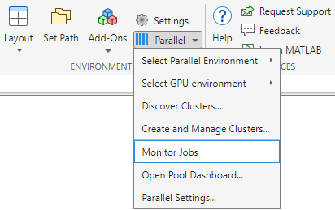
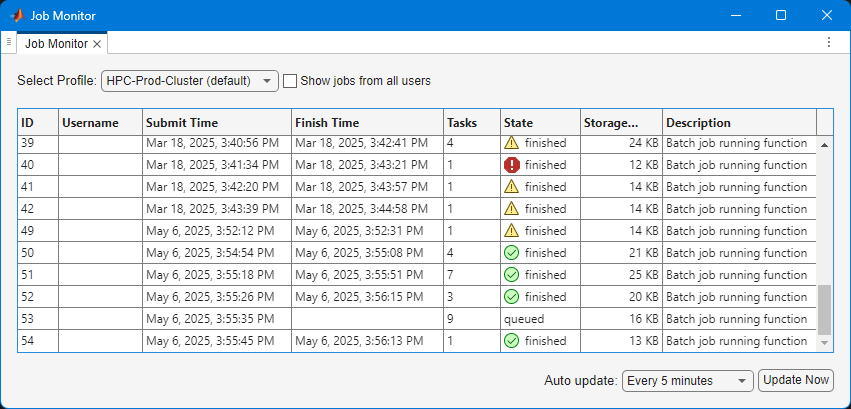

---
tags:
  - Academic
catalog:
  name: MATLAB Parallel Server
  description: Send MATLAB jobs from your computer to Roihu
  license_type: Academic
  disciplines:
    - Mathematics and Statistics
  available_on:
    - web_interfaces:
        - Roihu
    - Roihu
---

# Parallel Computing with MATLAB on the Roihu HPC Cluster

This document provides the steps to configure MATLAB to submit jobs to a cluster, retrieve results, and debug errors.

[TOC]

## License

For licensing, see [MATLAB license](matlab.md#license)

## Initial Configuration

This setup is intended for job submissions when MATLAB is installed on your machine and jobs are run remotely on the cluster.  This setup needs to be done once per cluster and per version of MATLAB installed on your machine.

Start MATLAB and run `userpath`

```matlab
userpath
```

Download the MATLAB plugin scripts from [here](https://github.com/CSCfi/csc-env-matlab/raw/refs/heads/main/config/csc.Desktop.zip).  The contents of the ZIP file should be extracted into the folder returned by the call to `userpath`.

Create a new cluster profile

```matlab
configCluster
```

Submission to the cluster requires SSH credentials. You will be prompted for username. **An SSH Agent must be running to serve the private key and certificate.** The certificate for the identity file expires after 24 hours and will need to be regenerated once it does. See the [CSC SSH certificate instructions](../computing/connecting/ssh-keys.md#signing-public-key) for a complete set of instructions. 

Jobs will now run on the cluster rather than on your local machine.

**NOTE**: To run jobs on your local machine instead of the cluster, use the `Processes` or `Threads` profile.

```matlab
% Get a handle to the local resources
c = parcluster('Processes');
```

## Configuring Jobs

Prior to submitting the job, various scheduler flags can be assigned, such as queue, e\-mail, walltime, etc.  *Only AccountName and WallTime are required.*

```matlab
% Get a handle to the cluster
c = parcluster;
```

Required flags:

```matlab
% Specify an account
c.AdditionalProperties.AccountName = '<project>';


% Specify the wall time (e.g., 1 day, 5 hours, 30 minutes)
c.AdditionalProperties.WallTime = '1-05:30';
```

Optional flags:

```matlab
% Specify memory to use, per core (default: 4GB)
c.AdditionalProperties.MemPerCPU = '6GB';


% Specify the partition
c.AdditionalProperties.Partition = 'partition-name';


% Specify a constraint
c.AdditionalProperties.Constraint = 'feature-name';


% Request email notification of job status
c.AdditionalProperties.EmailAddress = 'user-id@university.fi';


% Specify number of GPUs per node (default: 0)
c.AdditionalProperties.GPUsPerNode = 1;


% Specify a particular GPU card
c.AdditionalProperties.GPUCard = 'gh200';


% Specify number of nodes (default: 1)
c.AdditionalProperties.NumNodes = 2;

% Specify cores per node
c.AdditionalProperties.ProcsPerNode = 4;


% Set node exclusivity (default: false)
c.AdditionalProperties.RequireExclusiveNode = true;


% Specify a reservation
c.AdditionalProperties.Reservation = 'reservation-name';


```

To persist changes made to `AdditionalProperties` between MATLAB sessions, save the profile

```matlab
c.saveProfile
```

 To see the values of the current configuration options, display `AdditionalProperties`.

```matlab
c.AdditionalProperties
```

 Unset a value when no longer needed.

```matlab
% Turn off email notifications
c.AdditionalProperties.EmailAddress = '';


% Don't request an entire node
c.AdditionalProperties.RequireExclusiveNode = false;
```

## Independent Batch Job

Use the `batch` command to submit asynchronous jobs to the cluster. The `batch` command will return a job object which is used to access the output of the submitted job. See the MATLAB documentation for more help on [`batch`](https://www.mathworks.com/help/parallel-computing/batch.html).

```matlab
% Get a handle to the cluster
c = parcluster;


% Submit job to query where MATLAB is running on the cluster
job = c.batch(@pwd, 1, {}, CurrentFolder='.');


% Query job for state
job.State


% Wait for job to finish
job.wait


% If job is finished, fetch the results
job.fetchOutputs{1}


% Delete the job after results are no longer needed
job.delete
```

To retrieve a list of running or completed jobs, call `parcluster` to return the cluster object. The cluster object stores an array of jobs that are listed as *queued*, *running*, *finished*, or *failed*. Retrieve and view the list of jobs as shown below.

```matlab
c = parcluster;
jobs = c.Jobs


% Get a handle to the second job in the list
job2 = c.Jobs(2);
```

Once the job has been selected, fetch the results as previously done.

The `fetchOutputs` method retrieves output arguments; if calling `batch` with a script, use `load` instead. Data that has been written to disk on the cluster needs to be retrieved directly from the file system (e.g., via sftp) or can be brought back via a [FileStore](https://www.mathworks.com/help/parallel-computing/parallel.filestore.html).

```matlab
% Fetch all results from the second job in the list
job2.fetchOutputs{:}


% Alternate: Load results if job was a script instead of a function
job2.load
```

## Parallel Batch Job

The `batch` command can also support parallel workflows. Let’s use the following example for a parallel job, which you should save separately as `parallel_example.m`.

```matlab
function [sim_t, A] = parallel_example(iter)


if nargin==0
    iter = 8;
end


disp('Start sim')


A = nan(iter,1);
t0 = tic;
parfor idx = 1:iter
    A(idx) = idx;
    pause(2)
    idx
end
sim_t = toc(t0);


disp('Sim completed')


save RESULTS A


end
```

This time when using the `batch` command, specify a Pool argument.

```matlab
% Get a handle to the cluster
c = parcluster;


% Submit a batch pool job using 4 workers for 16 simulations
job = c.batch(@parallel_example, 1, {16}, CurrentFolder='.', Pool=4);


% View current job status
job.State


% Wait for job to finish
job.wait


% Fetch the results after a finished state is retrieved
job.fetchOutputs{1}
ans =
    8.8872
```

The job ran in 8.89 seconds using four workers. Note that these jobs will always request `N+1` CPU cores, since one worker is required to manage the batch job and pool of workers. For example, a job that needs eight workers will require nine CPU cores.

Run the same simulation again but increase the Pool size. This time, to retrieve the results later, keep track of the job ID.

**NOTE**: For some applications, there will be a diminishing return when allocating too many workers, as the overhead may exceed computation time.

```matlab
% Get a handle to the cluster
c = parcluster;


% Submit a batch pool job using 8 workers for 16 simulations
job = c.batch(@parallel_example, 1, {16}, CurrentFolder='.', Pool=8);


% Get the job ID
id = job.ID
id =
    4


% Clear job from workspace (as though MATLAB exited)
clear job
```

With a handle to the cluster, the `findJob` method searches for the job with the specified job ID.

```matlab
% Get a handle to the cluster
c = parcluster;


% Find the old job
job = c.findJob('ID', 4);


% Retrieve the state of the job
job.State
ans =
    finished


% Fetch the results
job.fetchOutputs{1};
ans =
    4.7270
```

The job now runs in 4.73 seconds using eight workers. Run code with different numbers of workers to determine the ideal number to use.

Alternatively, to retrieve job results via a graphical user interface, use the Job Monitor (`Parallel > Monitor Jobs`).





## Debugging

If a serial job produces an error, call the `getDebugLog` method to view the error log file.

When submitting an independent job, specify the task.

```matlab
c.getDebugLog(job.Tasks)
```

For Pool jobs, only specify the job object.

```matlab
c.getDebugLog(job)
```

When troubleshooting a job, the cluster admin may request the scheduler ID of the job. This can be derived by calling `getTaskSchedulerIDs`.

```matlab
job.getTaskSchedulerIDs()
ans =
    25539
```

## Helper Functions

| **Function** <br>  | **Description** <br>   |
| :-- | :-- |
| clusterFeatures <br>  | Lists cluster features/constraints <br>   |
| clusterGpuCards <br>  | Lists cluster GPU cards <br>   |
| clusterPartitionNames <br>  | Lists cluster partition names <br>   |
| cscTools <br>  | Collection of tools (print\_affinity, projects, workspaces, seff, etc.) <br>   |
| willRun <br>  | Explains why job is queued <br>   |

## To Learn More

To learn more about the MATLAB Parallel Computing Toolbox, check out these resources:

- [Parallel Computing Overview](http://www.mathworks.com/products/parallel-computing/index.html)
- [Parallel Computing Documentation](https://www.mathworks.com/help/overview/parallel-computing.html)
- [Parallel Computing Coding Examples](https://www.mathworks.com/help/parallel-computing/examples.html)
- [Parallel Computing Tutorials](http://www.mathworks.com/products/parallel-computing/tutorials.html)
- [Parallel Computing Videos](http://www.mathworks.com/products/parallel-computing/videos.html)
- [Parallel Computing Webinars](http://www.mathworks.com/products/parallel-computing/webinars.html)
