# Networking in Pouta
Every cPouta project comes with a default network and router configuration enough for most purposes. Most often, you don't need to worry about the network or router configuration and you can create virtual machines using the defaults.

In the situation that your project is missing a default network you will not be able to create a virtual machine. And if you are missing a router, you will not be able to attach ports (a port is a connection point for attaching a single device to a network) to your machine, for example to assign it a floating IP.

If you find yourself in need of creating a network and/or router, you can recreate the default settings via the web interface with the following instructions.

## Create a network

1. Open [cPouta](https://pouta.csc.fi) and navigate to **Network > Networks**. Click on **Create Network** button on the upper right. A new window will open.

    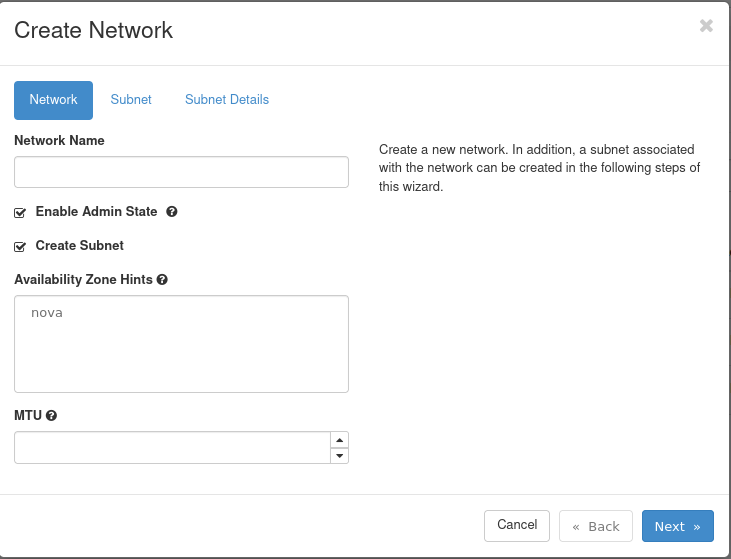

    - **Network Name** - Specify a name for your network.
    - **Enable Admin State** - Keep this checked so the network is active and usable right away.
    - **Create Subnet** - Leave checked if you also want to create a subnet for this network now.
    - **Availability Zone Hints** - Leave as "nova" unless your project uses a different availability zone.
    - **MTU** - Leave empty to use the default MTU; only set this if your use case requires a specific value.

1. When done, click on **Next**. If **Create Subnet** was checked, this will open the next tab for the subnet details.

    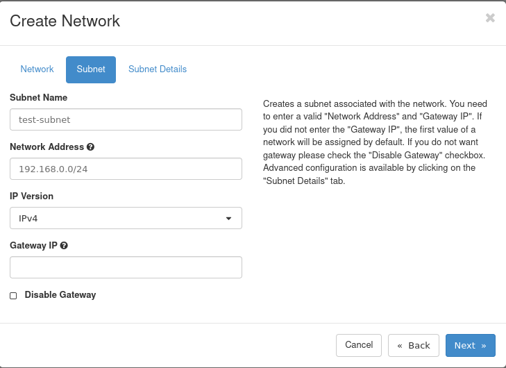

    - **Subnet Name** - Specify a name for your subnet.
    - **Network Address** - Specify the network address in CIDR format, for example `192.168.0.0/24`. Here is a [link](https://www.calculator.net/ip-subnet-calculator.html) that could help you calculate it.
    - **IP Version** - Leave as IPv4 unless you specifically need an IPv6 subnet.
    - **Gateway IP** - Optional. If left empty, the first address of the network will be used as the gateway. Check **Disable Gateway** if you don't want this subnet to have a gateway at all.

1. You can click on **Next**.

    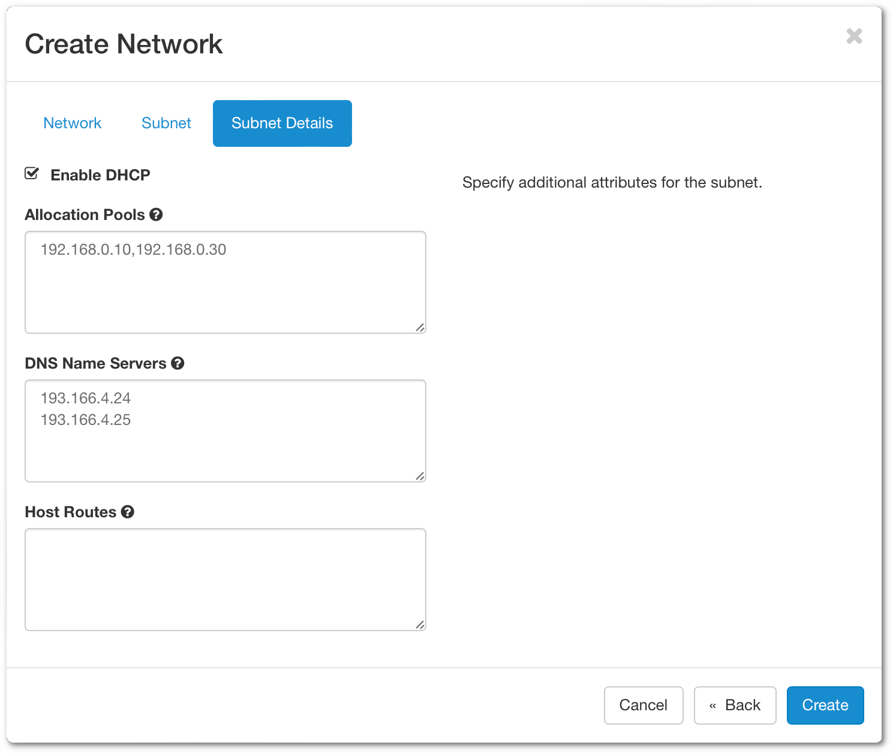

    By default, **Enable DHCP** is activated. If you disable **Enable DHCP**, instances on this subnet will not be assigned an IP automatically.

    - **Allocation Pools** - The IP range DHCP will hand out to instances, as a comma-separated start,end pair, for example `192.168.0.10,192.168.0.30`.
    - **DNS Name Servers** - Enter `193.166.4.24` and `193.166.4.25` (see screenshot above), one per line.
    - **Host Routes** - Optional. Leave empty unless you need custom static routes for this subnet.

1. In the end, you can click **Create** and you should see your network in the list.

## Create a router

A router will bridge the connection from **external** to the **private network**.

1. Navigate to **Network > Routers**. Click on **Create Router** on the upper right. A new window will open.

    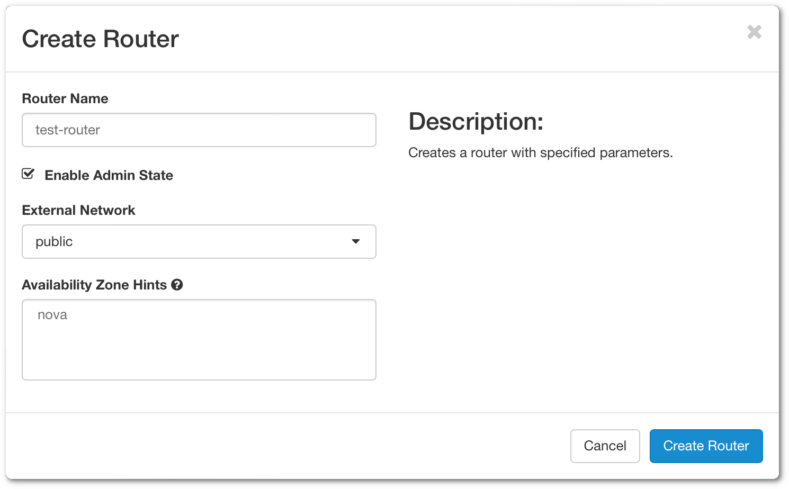

    - **Router Name** - Specify a name for your router.
    - **Enable Admin State** - Keep this checked so the router is active and usable right away.
    - **External Network** - Choose the external network this router will connect to (usually `public`).
    - **Availability Zone Hints** - Leave as "nova" unless your project uses a different availability zone.

1. After filling in the necessary fields, you can click on **Create Router**

1. Now that you have the **router** created, you need to attach it to your internal network to allow communication with the external. Click on your newly created router, go to the **Interfaces** tab, and click **Add Interface**.

    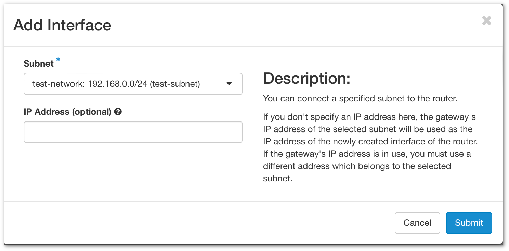

    - **Subnet** - Select the subnet you want to attach to this router.
    - **IP Address** - Optional. If left empty, the subnet's gateway IP address will be used for this interface. If that address is already in use, you must specify a different address within the subnet.

1. Now that you have attached your interface to the router, you are able to connect to the external network. You can see a graph by clicking on **Network > Network Topology** and selecting the **Graph** tab.

    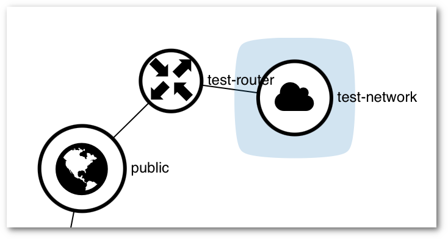

!!! info

    If you want to access your instances from an external network, you need to associate a [floating IP](launch-vm-from-web-gui.md#post-creation-step).  
    A floating IP sticks with your instance until you decide to release it.

* If you want to use the CLI command:

```sh
$ openstack network create test-network
$ openstack subnet create --dns-nameserver 193.166.4.24 --dns-nameserver 193.166.4.25 \
    --network $(openstack network list -f value -c ID -c Name|grep test-network|cut -d " " -f1) \
    --subnet-range 192.168.0.0/24 --allocation-pool start=192.168.0.10,end=192.168.0.30 test-network
$ openstack router create test-router
$ openstack router set --external-gateway public test-router
$ openstack router add subnet test-router test-network
```

## Security groups

Security groups are sets of firewall rules which limit access to your machines. A virtual machine can use one or more security groups. And one security group can be assigned to one or more virtual machines. A security group can hold one or more rules. These firewall rules are made on the OpenStack layer and you may have additional firewall rules within your virtual machine. In case of connectivity problems, you should make sure both the security group and the virtual machine's internal firewall are correctly configured.

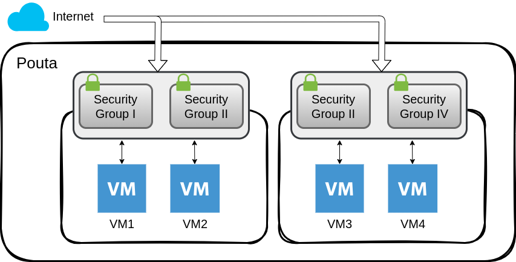

A security group can be edited or created in any moment of the Virtual Machine life-cycle. Any change applied to a security group assigned to a virtual machine will be applied instantly to it. There is no cost associated to security groups.

* The **recommendation** is to aim for a set of groups and rules that are _organized_ in a way that helps understanding the objective of each of them. Each service should have its own security group, and both the name and description should clearly state what this group provides and opens access to (destination ports) and from (source IPs).

    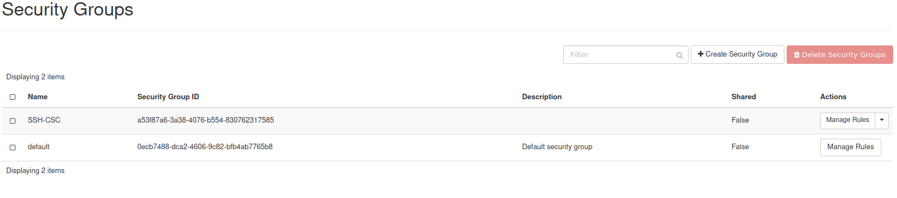

    In the example above we have 3 security groups other than the `default` one, two internal for monitoring and management, and one public for the service we offer to our users.

    !!! Info "Instance view"
        The instance view shows all the configurations of a VM, including all the security groups added to it, and the configuration of each of them. It is very useful to debug network connections issues and confirm the security of a VM.

* The `default` security group comes with rules that allow internal communication between virtual machines that are members of the security group:

    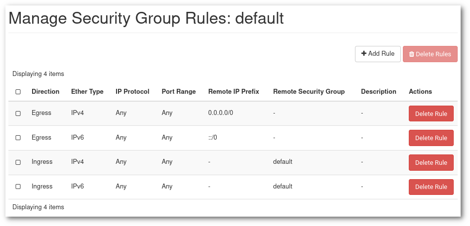

    !!! Warning "Do not modify the default security group"
        While it is allowed to edit the default security group, it is not advisable. Some of the initialization procedures rely on the default security group configuration.

    In the `default` security group, the first two rules allow for traffic to exit (`Egress`) to Any `IP` or `Port`. The last two rules allow communications among any member of the `default` security group, also for any `IP` or `Port`. This means that by default any VM is able to contact anywhere in the public internet and among themselves. This can be restricted in environments that require tighter security, but it should be done with the understanding of the requirements.

### Create a security group

1. For a new empty project, only the default security group will be there. Navigate to **Network > Security Groups**. Click on **Create Security Group** button on the upper right. A new window will open.

    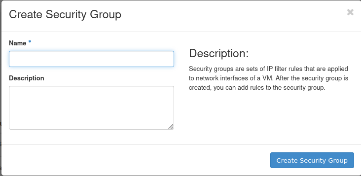

1. Provide a **Name** and a **Description** for the security group, then click **Create Security Group**. You will be taken back to the Security Groups list.

1. Find your newly created group in the Security Groups list and click **Manage Rules** in the **Actions** column. In the view that is displayed, click **Add Rule**.

    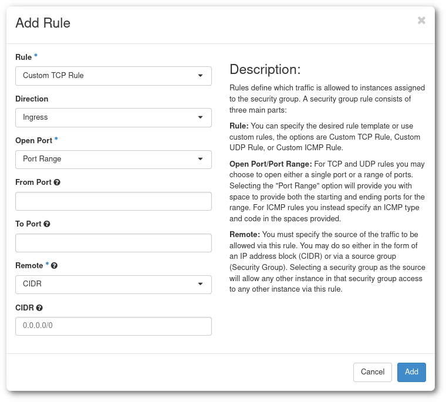

    - **Rule** has several options:
        - There is a list of protocols (DNS, HTTP, IMAP, ...), they provide a somewhat simpler way to create a rule. For example the `SSH` protocol only requires to input the CIDR that will be allowed by this rule.
        - The 3 more generic and configurable options are **Custom TCP Rule**, **Custom UDP Rule** and **Custom ICMP Rule**, they are the ones that allow the most fine tuning of the firewall options.
        - Finally the **All ICMP/TCP/UDP** open all ports for a given protocol to a given CIDR. They are only advisable for tests and when the list of allowed IPs is restricted and controlled.
    - **Description** is not compulsory, but advisable for complex security groups with several rules. For example, when adding several IP ranges, the description should state what these IPs are associated with (office network, VPN, ...).
    - **Direction** can be Ingress or Egress. In principle, most rules will be Ingress rules as by default Egress is open.
    - **Open Port** can be single **Port**, **Port Range**, or **All ports**.
    - **Port** or **Port Range** is self-explanatory. If you do not know which port to open, an alternative option is to use one of the predefined protocols in **Rule**.
    - **Remote** specifies the source of the traffic allowed by this rule. It can be either a **CIDR** or a **Security Group**:
        - **CIDR** or Classless Inter-Domain Routing is a way to specify ranges of IPs. You can specify a single IP by adding the `/32` suffix (`188.184.77.250/32`), or a wider range such as a `/16` subnet (`188.184.0.0/16`).
        - **Security Group** - Instead of an IP range, you can select another security group as the source. This allows any instance that is a member of that security group to access this rule's destination, without needing to know their individual IP addresses.

A security group can hold as many rules as needed.

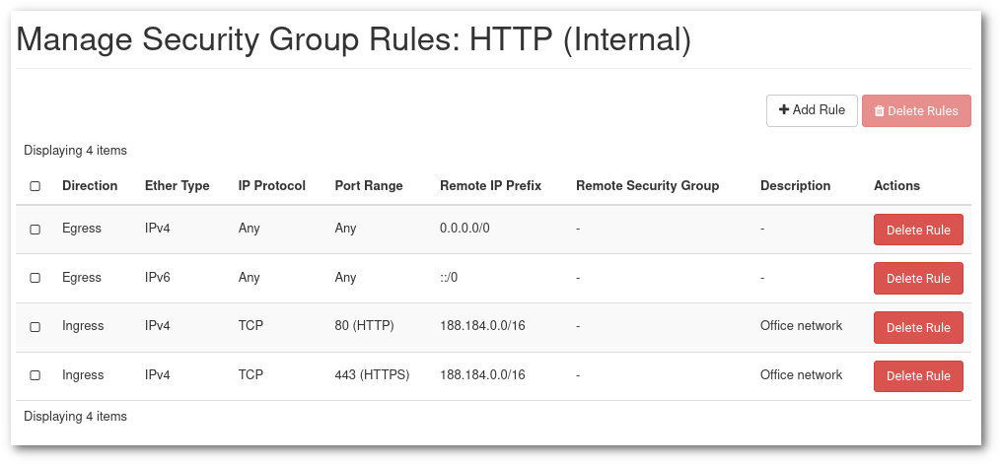

In the example above we have the opening of ports `80` (http) and `443` (https) to the subnet `188.184.0.0/16` ([`188.184.0.0` to `188.184.255.255`]).
