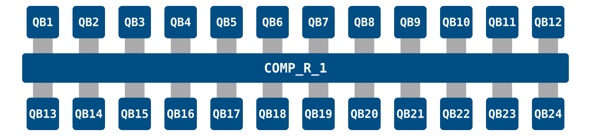

# LUMI-Q VLQ

The LUMI-Q VLQ is a superconducting star IQM quantum computer deployed as a joint collaboration between EuroHPC JU and the LUMI-Q Consortium hosted by IT4Innovation in Czechia. To serve all involved parties, the access mechanism differs from standard CSC quantum computers access method. Below we provide an overview as well as particular steps to be taken.

## Specification

| Property | Value |
| --- | --- |
| Qubits | 24 |
| Operator | IT4Innovation |
| Manufacturer | IQM |
| Qubit technology | Superconducting |
| Topology | Star (one-to-all connectivity) |
| Native gates | Two-qubit Controlled-Z (CZ) and one-qubit Phased RX (PRX), MOVE |
| Known hardware issues | None |
| Terms of use | None |

For more info on the move operation see [IQM academy](https://www.iqmacademy.com/learn/star/01-move/).

## Runtime identifiers

Due to the differing access method of VLQ you do not need to (and should not) specify runtime identifiers when running quantum jobs on VLQ from LUMI. Below is an example batch script you can use for VLQ.

```bash
#!/bin/bash

#SBATCH --job-name=quantumjob   # Job name
#SBATCH --account=project_<id>  # Project for billing (slurm_job_account)
#SBATCH --partition=standard   # Partition (queue) name
#SBATCH --ntasks=1              # One task (process)
#SBATCH --mem-per-cpu=2G       # memory allocation
#SBATCH --cpus-per-task=1     # Number of cores (threads)
#SBATCH --time=00:05:00         # Run time (hh:mm:ss)

module use /appl/local/quantum/modulefiles
module load lumi-q-qiskit/vlq

python your_python_script.py
```

## Topology

VLQ's qubits are connected to a central computational resonator providing one-to-all connectivity.

??? default "Topology mapping (Click to show)"

    { width=100% style="display: block; margin: 0 auto;" }

## Access

If you do not yet have a VLQ project see the [Access](../access.md) page for info on applying for one.

## Configure the environment

=== "LUMI"

    On LUMI there exists a preconfigured environment for using VLQ. It can be accessed by loading the following module.

    ```bash
    module use /appl/local/quantum/modulefiles    
    module load lumi-q-qiskit/vlq
    ```

=== "Local"

    VLQ also provides API access so it can be accessed outside of LUMI. Locally it is recommended to follow the instructions in [IT4I VLQ docs](https://docs.it4i.cz/en/docs/clusters/vlq/access#set-up-python-environment).

## Get your access token

For VLQ you need to get your own access token using MyAccessID. This can be done via the below python script.

=== "Interactive"

    For unteractive jobs you can use the standard method documented in the [IT4I VLQ docs](https://docs.it4i.cz/en/docs/clusters/vlq/access).

    ```python
    # Import packages
    from py4lexis.session import LexisSession

    # Authentication
    lexis_session = LexisSession()
    token = lexis_session.get_access_token()
    ```

    This will attempt to open a browser window where you are prompted to login. If no window opens copy paste the printed URL to a browser.

=== "Batch"

    For jobs submitter through the Slurm batch scheduler one needs to save an offline scoped token to a file from which it can be read at run time. You can run this either as an interactive job on LUMI before submitting your batch job or locally on your machine and transfer the token to LUMI yourself.

    ```python
    from py4lexis.core.session import LexisSession

    lexis_session = LexisSession(offline_access=True)
    print("Generating new token.")
    offline_token = lexis_session.get_refresh_token()
    with open("offline_token", "w") as text_file:
        text_file.write(offline_token)
    ```

    This will attempt to open a browser window where you are prompted to login. If no window opens copy paste the printed URL to a browser.

    To use the offline token to get an access token without going through the browser login include the following in your python script

    ```python
    from pathlib import Path
    from py4lexis.session import LexisSessionToken

    TOKEN_FILE = Path("offline_token")

    session = LexisSessionToken(
        refresh_token=TOKEN_FILE.read_text().strip(),
        reraise_exceptions=True,
        suppress_welcome=True,
    )

    PROJECT = "VLQ-CSC"
    RESOURCE = "VLQ-FI"

    TOKEN_FILE.write_text(session.get_refresh_token())
    TOKEN_FILE.chmod(0o600)

    token=session.get_access_token()
    ```

!!! info "Next step"
    See [Quantum as a Service (IT4I) docs](https://it4innovations.github.io/quantum-as-a-service/usage)

## Further Reading
* [Quantum as a Service (IT4I) docs](https://it4innovations.github.io/quantum-as-a-service/usage)
* [IT4I VLQ docs](https://docs.it4i.cz/en/docs/clusters/vlq/access)
* [LUMI Documentation](https://docs.lumi-supercomputer.eu/){ target=_blank }
* [Qiskit adapter for IQM devices](https://docs.meetiqm.com/iqm-client/user_guide_qiskit){ target=_blank }
* [Cirq adapter for IQM devices](https://docs.meetiqm.com/iqm-client/user_guide_cirq){ target=_blank }