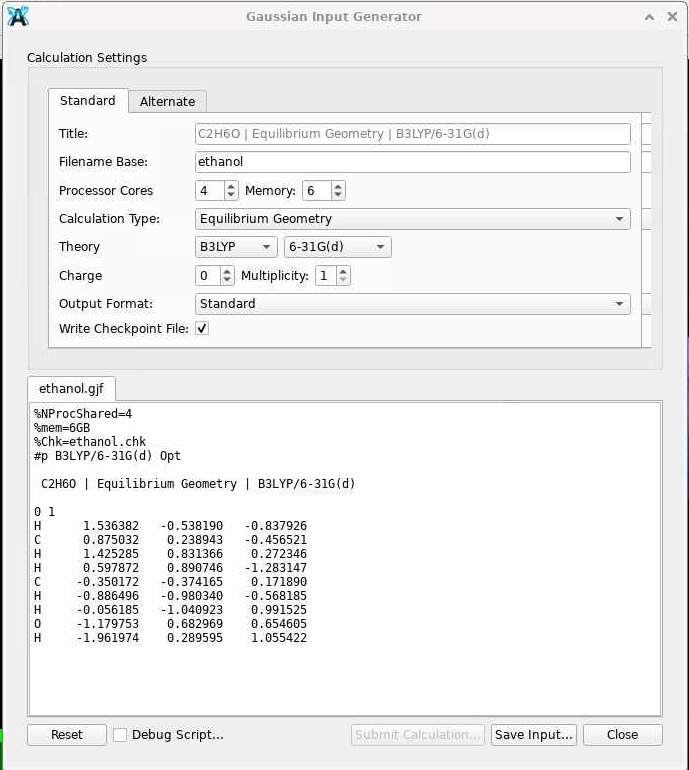

# Using Avogadro2 with Gaussian and ORCA on Roihu

Avogadro2 is a molecular editor. On Roihu it runs in the web interface, so you can build a molecule, create an input file, and open the result in one place. In this tutorial you build ethanol, optimize it, and run a B3LYP geometry optimization with Gaussian or ORCA.

For all options of the programs, see the [Avogadro2 manual](https://two.avogadro.cc/docs/), [Gaussian](../../apps/gaussian.md) and [ORCA](../../apps/orca.md) pages.

## 1. Launch Avogadro2

Log in to the [Roihu web interface](../../computing/webinterface/index.md) and start **Avogadro2** from the app list. <!-- VERIFY: link target and app name in the OOD dashboard -->


<!-- SCREENSHOT 1: avogadro2-roihu-launch.png -->

## 2. Build ethanol

1. Select the **Draw** tool and set the element to carbon.
2. Click twice in the workspace to draw two carbon atoms joined by a bond.
3. Set the element to oxygen and click the end of the chain.
4. Add hydrogen atoms: **Build → Add Hydrogens**. <!-- VERIFY: menu name; hydrogens may be added automatically -->

Rotate with the left mouse button, zoom with the scroll wheel.


<!-- SCREENSHOT 2: avogadro2-ethanol-build.png (annotate the Draw tool, 1-2 arrows) -->

## 3. Optimize the geometry

Run a quick force field optimization to remove bad bond lengths and angles:

**Extensions → Optimize Geometry**

The default force field (UFF or MMFF94) is sufficient for ethanol. To change it, use the force field setup entry in the same menu. <!-- VERIFY: exact menu entries and default force field -->

## 4. Create the input file

Open the input generator from the menu and use these settings.
<!-- VERIFY: menu path (Extensions or Input), button names (Generate / Copy) -->

=== "Gaussian"

    Open the **Gaussian** input generator.

    | Setting | Value |
    |---|---|
    | Calculate | Equilibrium Geometry |
    | Theory | B3LYP |
    | Basis | 6-31G(d) |
    | Processor cores | same as in your job (see step 5) |
    | Memory | same as in your job (see step 5) |
    | Charge / Multiplicity | 0 / 1 |

    Save the file as `ethanol.com`.

    
    <!-- SCREENSHOT 3a: avogadro2-gaussian-dialog.png -->

=== "ORCA"

    Open the **ORCA** input generator.

    | Setting | Value |
    |---|---|
    | Calculate | Equilibrium Geometry |
    | Theory | B3LYP |
    | Basis | def2-SVP |
    | Processor cores | same as in your job (see step 5) |
    | Memory | same as in your job (see step 5) |
    | Charge / Multiplicity | 0 / 1 |

    Save the file as `ethanol.inp`.

    
    <!-- SCREENSHOT 3b: avogadro2-orca-dialog.png -->

Save the file in a new directory in your project scratch area, for example `/scratch/project_<number>/ethanol_opt/`.

!!! note
    The number of cores and the memory in the input file must match the resources of the batch job. In Gaussian they are set by `%NProcShared` and `%Mem`, in ORCA by `%pal nprocs` and `%maxcore` (memory per core).

## 5. Run the calculation

Open a terminal in the web interface (or log in with SSH) and go to the directory:

```bash
cd /scratch/project_<number>/ethanol_opt
```

=== "Gaussian"

    ```bash
    module load gaussian
    subg16 ethanol.com
    ```
    <!-- VERIFY: module name and subg16 syntax against gaussian.md -->

=== "ORCA"

    Create `run_orca.sh`:

    ```bash
    #!/bin/bash
    #SBATCH --account=project_<number>
    #SBATCH --partition=<partition>
    #SBATCH --ntasks=4
    #SBATCH --mem-per-cpu=2G
    #SBATCH --time=00:10:00

    module load orca
    $(which orca) ethanol.inp > ethanol.out
    ```
    <!-- VERIFY: partition, module name, orca call (full path needed for parallel runs) against orca.md -->

    Submit it:

    ```bash
    sbatch run_orca.sh
    ```

The job is small and should finish in a few minutes.

## 6. Check the result

Follow the output while the job runs:

=== "Gaussian"

    ```bash
    tail -f ethanol.log
    ```

    The optimization is finished when the file contains `Optimization completed` and ends with `Normal termination`.

=== "ORCA"

    ```bash
    tail -f ethanol.out
    ```

    The optimization is finished when the file contains `OPTIMIZATION RUN DONE` and ends with `ORCA TERMINATED NORMALLY`.

Press `Ctrl+C` to stop `tail`.

## 7. View the optimized structure

In Avogadro2, open the result with **File → Open**:

- Gaussian: `ethanol.log`
- ORCA: `ethanol.xyz` (final geometry written by ORCA) <!-- VERIFY: Avogadro2 reads both files -->

Compare it with the starting structure, for example the C–O bond length and the H–O–C angle.


<!-- SCREENSHOT 4: avogadro2-optimized-ethanol.png -->

## 8. Frequency calculation

A frequency calculation on the optimized geometry confirms that it is a minimum. Open the optimized structure, create a new input file, and add `Freq` to the job line:

=== "Gaussian"

    ```text
    # B3LYP/6-31G(d) Opt Freq
    ```

=== "ORCA"

    ```text
    ! B3LYP def2-SVP Opt Freq
    ```

A minimum has no imaginary frequencies. An imaginary frequency is printed as a negative number. One imaginary frequency means a transition state, or a structure that needs more optimization.

## Common problems

- **SCF does not converge:** check the charge and multiplicity, and the starting geometry.
- **Job stops at the time limit:** increase `--time` and restart from the last geometry.
- **Wrong energy or an error at start:** check that charge and multiplicity are correct.

See the [Gaussian](../../apps/gaussian.md) and [ORCA](../../apps/orca.md) pages for more.
