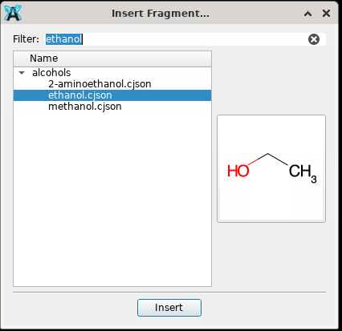
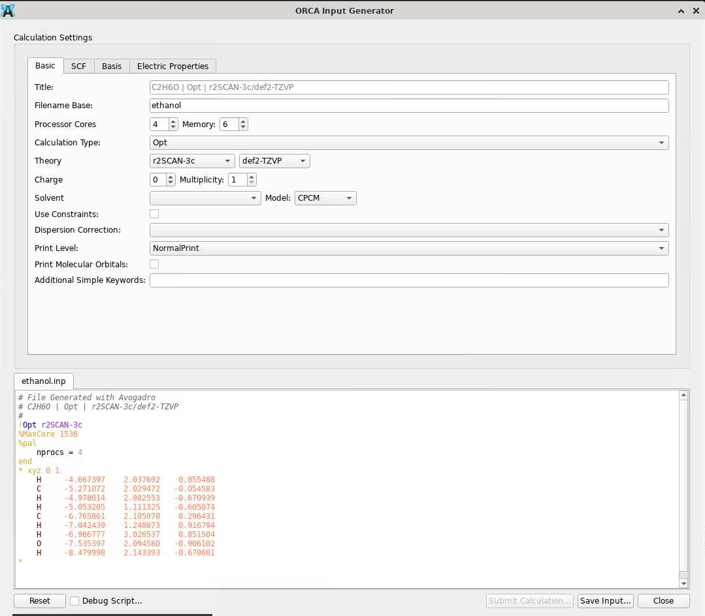
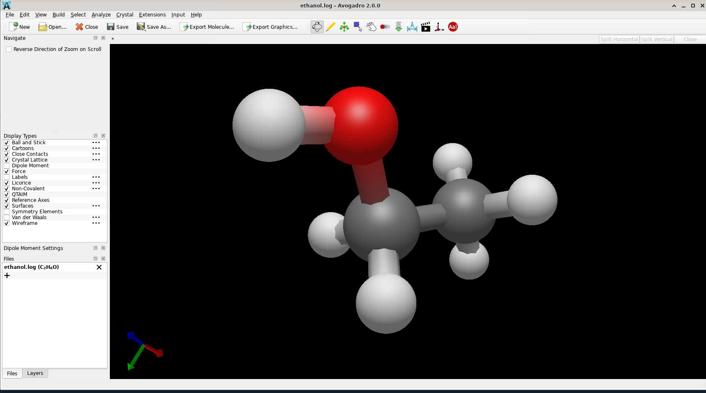

# Using Avogadro2 with Gaussian and ORCA on Roihu

Avogadro2 is a molecular editor. On Roihu it runs in the Desktop app of the web interface, so you can build a molecule, create an input file, and open the result in one place. In this tutorial you build ethanol, optimize it, and run a geometry optimization with Gaussian (B3LYP) or ORCA (r2SCAN-3c).

For all options, see the [Avogadro2](../../apps/avogadro2.md), [Gaussian](../../apps/gaussian.md) and [ORCA](../../apps/orca.md) pages.

## 1. Start Avogadro2

1. In the [Roihu web interface](https://www.roihu.csc.fi), select **Apps → Desktop**.
2. Select your **Project** and the **Partition** `interactive`, set **Memory (GiB)** to 4, and click **Launch**.
3. In **My Interactive Sessions**, click **Launch Desktop** when the session is **Running**.
4. In the desktop, double-click **Avogadro 2**. If a **Version Update** window appears, select **Ignore**.

See the [Desktop](../../computing/webinterface/desktop.md) page for more.

## 2. Build ethanol

Select **Build → Insert → Molecule...**, type `ethanol` in the **Filter** field, select `ethanol.cjson` in the `alcohols` category, and click **Insert**.

To draw a molecule instead, see [Building a structure](../../apps/avogadro2.md#building-a-structure).



## 3. Optimize with a force field

Select **Extensions → Open Babel → Optimize Geometry**. This gives a reasonable start geometry. To change the force field, use **Extensions → Open Babel → Configure Force Field...**.

## 4. Create the input file

Create the directory first. Avogadro2 does not create directories, and **Save Input...** fails if the directory does not exist. In the terminal window that opens with Avogadro2:

```bash
mkdir -p /scratch/<project>/ethanol_opt
```

Open the generator from the **Input** menu. Use the same values for both programs: 4 processor cores and 6 GiB of memory.

=== "Gaussian"

    Select **Input → Gaussian...**.

    | Setting | Value |
    |---|---|
    | Filename Base | ethanol |
    | Processor Cores | 4 |
    | Memory | 6 (GB) |
    | Calculation Type | Equilibrium Geometry |
    | Theory | B3LYP, 6-31G(d) |
    | Charge / Multiplicity | 0 / 1 |

    The preview shows `%NProcShared=4`, `%mem=6GB` and the route line `#p B3LYP/6-31G(d) Opt`. Click **Save Input...** and save the file as `/scratch/<project>/ethanol_opt/ethanol.com`. `subg16` reads the input as `<jobname>.com`, so type the full name in the **File name** field.

    

=== "ORCA"

    Select **Input → ORCA...**.

    On the **Basic** tab:

    | Setting | Value |
    |---|---|
    | Filename Base | ethanol |
    | Processor Cores | 4 |
    | Memory | 6 (GiB) |
    | Calculation Type | Opt |
    | Theory | r2SCAN-3c (default) |
    | Charge / Multiplicity | 0 / 1 |
    | Print Molecular Orbitals | off |

    r2SCAN-3c is a composite method with its own basis set, so no basis set is given in the keyword line. The input has `nprocs = 4` in the `%pal` block and `%MaxCore 1536` (MB per process). Click **Save Input...** and save the file as `/scratch/<project>/ethanol_opt/ethanol.inp`.

    

Use a separate directory for each calculation. The generators only write the input file. The program must be available on Roihu.

## 5. Run the calculation

Run the calculation as a batch job. Submit it from the Roihu CPU login node.

=== "Gaussian"

    ```bash
    cd /scratch/<project>/ethanol_opt
    module load gaussian
    subg16 00:30:00 ethanol <project>
    ```

    The arguments are the run time, the job name (the input file `ethanol.com` without the extension), and the billing project. The number of cores and the memory are read from `%NProcShared` and `%mem` in the input file.

=== "ORCA"

    ORCA is not installed centrally at CSC. Install a private copy first, see the [ORCA](../../apps/orca.md) page.

    Create `job.sh` in the same directory as `ethanol.inp`:

    ```bash
    #!/bin/bash
    #SBATCH --partition=small
    #SBATCH --nodes=1
    #SBATCH --ntasks-per-node=4       # same as %pal nprocs
    #SBATCH --mem-per-cpu=1536        # MB, same as %MaxCore
    #SBATCH --account=<project>
    #SBATCH --time=00:30:00

    export ORCADIR=/projappl/<project>/<user>/orca/<orca-directory>
    module purge
    module load orca/6.1.1

    ${ORCADIR}/orca ethanol.inp > ethanol.out
    ```

    ```bash
    cd /scratch/<project>/ethanol_opt
    sbatch job.sh
    ```

The calculation takes less than a minute. The time in the queue can be longer.

## 6. Check the result

Check the job with:

```bash
squeue -u $USER
```

The job is finished when it is no longer in the list. Then check the end of the output:

=== "Gaussian"

    ```bash
    grep -E 'Optimization completed|Normal termination' ethanol.log
    ```

=== "ORCA"

    ```bash
    grep -E 'OPTIMIZATION RUN DONE|ORCA TERMINATED NORMALLY' ethanol.out
    ```

Both lines should be printed.

## 7. View the optimized structure

In Avogadro2, select **File → Open** and open the output file: `ethanol.log` (Gaussian) or `ethanol.out` (ORCA).

Compare the structure with the start geometry, for example the C–O bond length.



## 8. Frequency calculation

A frequency calculation confirms that the optimized structure is a minimum. It must use the optimized structure:

1. In Avogadro2, open the output file of the optimization (`ethanol.log` or `ethanol.out`, see step 7). The window holds the optimized structure. Do not run the force-field optimization again. <!-- VERIFY: window holds the final optimization geometry -->
2. Open the input generator as in step 4 and change two settings: set **Filename Base** to `ethanol_freq`, and set **Calculation Type** to `Frequencies` (Gaussian) or `Freq` (ORCA). <!-- VERIFY: Gaussian calculation type name -->
3. Click **Save Input...** and save the file in the same directory as `ethanol_freq.com` (Gaussian) or `ethanol_freq.inp` (ORCA).

Submit the job as in step 5, with the new name:

=== "Gaussian"

    ```bash
    subg16 00:30:00 ethanol_freq <project>
    ```

=== "ORCA"

    Change the last line of `job.sh` and submit it again:

    ```bash
    ${ORCADIR}/orca ethanol_freq.inp > ethanol_freq.out
    ```

When the job has finished, open `ethanol_freq.log` (Gaussian) or `ethanol_freq.out` (ORCA) in Avogadro2 and select **Analyze → Vibrational Modes...**. <!-- VERIFY: Vibrational Modes works with the Gaussian log -->

A minimum has no imaginary frequencies. An imaginary frequency is shown as a negative number. One imaginary frequency means a transition state, or a structure that needs more optimization. Select a mode to animate it, or select **Analyze → Plot Spectra...** for the IR spectrum.

To optimize and calculate the frequencies in one job, add `Freq` to the job line of the input of step 4 (`#p B3LYP/6-31G(d) Opt Freq` for Gaussian, `!Opt r2SCAN-3c Freq` for ORCA).

## Hints

Start with a cheap method and refine the result step by step. This saves resources while the structure is still far from the minimum:

1. Optimize with a force field in Avogadro2 (step 3).
2. Optimize with a small basis set or a composite method, as in this tutorial.
3. Calculate the final energy with a larger basis set or a more accurate method at the optimized geometry.

Use the output of each step as the start structure of the next step (open it in Avogadro2, see step 8), and check that each calculation finished normally before you continue.

See the [Gaussian](../../apps/gaussian.md) and [ORCA](../../apps/orca.md) pages for more.
